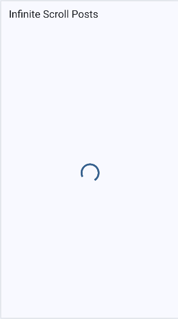
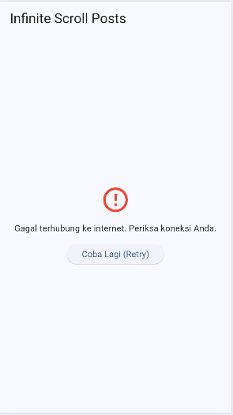

# Week 08 | Mid Project Review & Code Review

Repository Portfolio Mata Kuliah Pemrograman Mobile  
**NIM:** 244107020029  
**Topik:** Evaluasi Kesiapan Tengah Semester, Kolaborasi Git Flow, Peer Code Review, Static Analysis, dan AI-Assisted Review.

---

## 1. Status Paruh Semester (Mid-Project Overview)

Proyek paruh semester ini mengambil dan memperkuat fondasi aplikasi **Offline Notes** (dari portofolio Minggu 5–7). Aplikasi telah mengintegrasikan arsitektur offline-first dengan database lokal SQLite, manajemen state reaktif menggunakan Flutter Riverpod, persistensi pengaturan preferensi pengguna, sinkronisasi data kotor (*dirty records*), serta validasi masukan data yang kokoh.

### Ringkasan Pencapaian Tengah Semester:
- **Arsitektur & Pemisahan Layer:** Struktur proyek terorganisir rapi dan modular (`core/`, `data/`, `pages/`) serta mematuhi aturan dependensi.
- **Hygiene Git & Branching:** Penerapan Git Flow secara penuh dengan branch terlindungi `main`, branch integrasi mingguan `develop`, serta branch fitur terisolasi `feat/notes-validation`.
- **Standar Kualitas Mesin:** Lolos static analysis (`flutter analyze` 0 issues), penataan kode seragam (`dart format`), dan seluruh pengujian otomatis berhasil (`flutter test` 100% PASS).
- **Otomatisasi CI/CD:** Penolakan otomatis terhadap PR yang tidak memenuhi standar kualitas menggunakan workflow GitHub Actions (`.github/workflows/ci.yml`).
- **Verifikasi Review Sejawat & AI:** Seluruh temuan review sejawat dan saran AI telah diuji dan didokumentasikan secara sistematis.

---

## 2. Peta Issue & Pull Request (PR)

Alur kolaborasi pada proyek ini mengadopsi standar industri berbasis issue tracking dan peer code review:

```
[Issue #12: Validasi Catatan Kosong]
            │
            ▼
[Branch: feat/notes-validation] ──> [Commit Atomik Konvensional]
            │
            ▼
[Pull Request #12 ke branch develop]
            │
            ├──> [Pemeriksaan Mesin CI: flutter analyze & flutter test] -> PASSED
            │
            ├──> [Peer Code Review & AI Review] -> Status: Request Changes
            │      • Temuan 1: Bypass whitespace ("   ")
            │      • Temuan 2: Logika validasi perlu diekstrak ke core/validate.dart
            │      • Temuan 3: Test boundary karakter (max 100 char)
            │
            ├──> [Tindak Lanjut & Commit Perbaikan] -> Status: Approved
            │
            ▼
[Squash & Merge ke develop] ──> [Issue #12 Tertutup Otomatis]
```

Dokumentasi lengkap mengenai alur PR, komentar review, dan proses merge dapat dilihat pada:
📄 [docs/pr-review.md](file:///d:/github/Mobile/244107020029-mobile-course/08-week-8-mid-project-review/docs/pr-review.md)

---

## 3. Fitur Utama Aplikasi

1. **Penyimpanan Lokal Offline-First (SQLite):** Catatan disimpan secara lokal di database SQLite (`sqflite_common_ffi`) sehingga dapat diakses dan dimanipulasi tanpa ketergantungan koneksi internet.
2. **State Management Reaktif (Riverpod):** Menggunakan `FutureProvider` dan `StateNotifier` untuk menyajikan data catatan secara asinkron dan otomatis memicu *rebuild* widget saat terjadi mutasi data.
3. **Validasi Input Terpusat (`NoteValidator`):** Memvalidasi keberadaan judul, sanitasi whitespace spasi, serta pembatasan batas karakter (maksimal 100 karakter untuk judul dan 1000 karakter untuk isi).
4. **Indikator & Sinkronisasi Data (Dirty/Synced):** Indikator visual chip untuk menandai catatan yang belum tersinkronisasi (*dirty*) dan tombol aksi sinkronisasi manual.
5. **Dukungan Dark Mode:** Pengaturan tema gelap/terang yang tersimpan secara persisten pada SharedPreferences.

---

## 4. Stack Teknologi

- **Framework:** Flutter 3.x (Channel Stable)
- **Bahasa:** Dart 3.x
- **State Management:** Flutter Riverpod (`flutter_riverpod: ^2.5.1`)
- **Penyimpanan Lokal:** SQLite (`sqflite: ^2.3.0`, `sqflite_common_ffi: ^2.3.0`)
- **Preferensi:** SharedPreferences (`shared_preferences: ^2.2.2`)
- **Networking:** Dio HTTP Client (`dio: ^5.4.0`)
- **Testing:** Flutter Test Suite (`flutter_test`)
- **CI/CD:** GitHub Actions (`.github/workflows/ci.yml`)

---

## 5. Cara Menjalankan Aplikasi & Pengujian

### Prasyarat
Pastikan Flutter SDK telah terinstal dan terdaftar pada environment PATH:
```bash
flutter --version
dart --version
```

### Menjalankan Proyek
1. Masuk ke direktori proyek catatan offline:
   ```bash
   cd 05-week-5-local-storage-offline-first/week5_offline_notes
   ```
2. Unduh paket dependensi:
   ```bash
   flutter pub get
   ```
3. Jalankan aplikasi pada perangkat atau emulator target:
   ```bash
   flutter run
   ```

### Menjalankan Pemeriksaan Mesin (Static Analysis & Formatting)
1. **Pemeriksaan Static Analysis:**
   ```bash
   flutter analyze
   ```
   *Ekspektasi: `No issues found!`*

2. **Pemeriksaan Format Kode Dart:**
   ```bash
   dart format --set-exit-if-changed .
   ```
   *Ekspektasi: Seluruh file telah terformat rapi (exit code 0).*

3. **Menjalankan Pengujian Otomatis (Unit & Widget Test):**
   ```bash
   flutter test
   ```
   *Ekspektasi: `All tests passed!`*

---

## 6. Bukti Mesin Hijau (Green Builds)

### 6.1. Hasil `flutter analyze`
```text
Analyzing week5_offline_notes...
No issues found! (ran in 13.2s)
```

### 6.2. Hasil `dart format --set-exit-if-changed .`
```text
Formatted 16 files (0 changed) in 0.17 seconds.
```

### 6.3. Hasil `flutter test`
```text
00:00 +0: loading D:/github/Mobile/.../test/validate_note_test.dart
00:00 +0: NoteValidator - Unit Test Validasi Catatan mengembalikan pesan error ketika judul adalah null
00:00 +1: NoteValidator - Unit Test Validasi Catatan mengembalikan pesan error ketika judul adalah string kosong
00:00 +2: NoteValidator - Unit Test Validasi Catatan mengembalikan pesan error ketika judul hanya berisi spasi atau whitespace
00:00 +3: NoteValidator - Unit Test Validasi Catatan mengembalikan pesan error ketika judul melebihi batas 100 karakter
00:00 +4: NoteValidator - Unit Test Validasi Catatan mengembalikan null jika judul valid
00:00 +5: NoteValidator - Unit Test Validasi Catatan validasi body mengembalikan null untuk input kosong atau normal
00:00 +6: NoteValidator - Unit Test Validasi Catatan validasi body mengembalikan error jika melebihi 1000 karakter
00:00 +7: Smoke test verifikasi UI NotesPage dan validator catatan
00:04 +8: All tests passed!
```

---

## 7. Bukti Visual & Screenshot

Berikut dokumentasi tampilan visual aplikasi dan proses pengujian:

| Tampilan Daftar Catatan & Status Sync | Tampilan Form Tambah & Validasi Error |
|:---:|:---:|
|  |  |

---

## 8. Refleksi

### 1. Apa beda LGTM buta dengan approve yang bertanggung jawab? Apa risikonya bagi tim?
**Jawab:**
- **LGTM (Looks Good To Me) Buta** adalah tindakan memberikan persetujuan (*approve*) secara serampangan hanya berdasarkan penampakan sepintas, asumsi bahwa rekan satu tim pasti sudah menulis kode yang benar, atau sekadar formalitas agar fitur cepat dimerge tanpa benar-benar meneliti alur logika, menjalankan kode, maupun mengecek edge cases.
- **Approve yang Bertanggung Jawab** adalah penelaahan kode secara komprehensif di mana reviewer menarik (*pull*) branch tersebut ke lingkungan lokal, menjalankan static analysis dan automated test, menguji skenario batas (*edge cases*), memastikan arsitektur dan aturan dependensi tidak dilanggar, serta memverifikasi bahwa kode mudah dipahami dan dipelihara.
- **Risikonya bagi tim:** LGTM buta menyebabkan kode kotor (*code smell*), kebocoran memori, celah keamanan, dan bug regresi lolos ke branch utama (`main`/`develop`). Hal ini menimbulkan akumulasi utang teknis (*technical debt*) yang tinggi, memperlambat kecepatan rilis fitur berikutnya, serta dapat merusak reputasi produk dan kepuasan pengguna akibat aplikasi crash di lingkungan produksi.

---

### 2. Kapan komentar wajib berstatus request changes, dan kapan cukup saran?
**Jawab:**
- **Wajib berstatus *Request Changes* (Blocker):**
  1. Ditemukan **kegagalan logika bisnis atau bug fungsional** yang dapat merusak integritas data (misal: bypass spasi kosong pada validasi form).
  2. Adanya **celah keamanan** (misal: SQL Injection, kebocoran kredensial/API token, atau unhandled sensitive data).
  3. Terjadi **pelanggaran arsitektur** (misal: domain layer mengimpor pustaka UI/presentation atau direct dependency leak).
  4. Kode berpotensi memicu **memory leak / crash asinkron** (misal: penggunaan `BuildContext` lintas jeda asinkron tanpa memeriksa `mounted`).
  5. Pengujian (*test*) gagal atau belum ada test case untuk jalur kode kritis yang baru diubah.
- **Cukup berstatus *Saran* (Comment / Nitpick):**
  1. Usulan preferensi gaya penulisan atau penamaan variabel minor yang tidak memengaruhi logika, keamanan, maupun performa.
  2. Rekomendasi penggunaan fitur bahasa yang lebih modern jika pendekatan yang saat ini digunakan sudah valid dan aman.
  3. Saran dokumentasi opsional atau komentar penjelas tambahan.

---

### 3. Bagian mana dari review AI yang Anda tolak atau sederhanakan, dan mengapa?
**Jawab:**
Bagian rekomendasi AI yang **ditolak** adalah usulan penerapan pustaka *Functional Programming* (`fpdart`/`dartz`) untuk membungkus seluruh hasil validasi dan entity ke dalam bentuk *Monad Either / Value Objects* yang rumit.  
**Alasan Penolakan:**
Usulan tersebut merupakan bentuk ***over-engineering*** yang berlebihan untuk skala aplikasi catatan offline saat ini. Menambahkan dependensi eksternal monad memperberat ukuran kompilasi, memperumit kurva pemahaman anggota tim (*cognitive overhead*), dan melanggar prinsip desain **YAGNI (You Aren't Gonna Need It)** serta **KISS (Keep It Simple, Stupid)**. Kebutuhan validasi input form telah terselesaikan secara elegan, bersih, dan idiomatis menggunakan class murni `NoteValidator` yang mengembalikan `String?` tanpa overhead dependensi tambahan.

---

### 4. Satu hal konkret yang Anda perbaiki setelah review sejawat — apa dampaknya?
**Jawab:**
Satu hal konkret yang diperbaiki adalah **penanganan edge-case sanitasi spasi kosong (*whitespace validation*) pada input judul serta ekstraksi logika validasi ke dalam modul terisolasi `lib/core/validate.dart`**. Sebelumnya, validasi hanya menggunakan `if (titleController.text.isNotEmpty)` di dalam event button dialog, sehingga input berupa spasi `"   "` masih lolos dan tersimpan ke SQLite.  
**Dampaknya bagi proyek:**
1. **Integritas Data & UX Terjamin:** Pengguna tidak dapat lagi menyimpan catatan tanpa judul atau hanya berisi spasi. Tampilan `ListTile` pada aplikasi tetap rapi dan tidak ada record cacat di database SQLite.
2. **Modularitas & Kemudahan Pengujian:** Pemisahan logika validasi dari widget UI ke class `NoteValidator` memungkinkan logika diuji secara terisolasi melalui unit test (`test/validate_note_test.dart`) yang dieksekusi secara instan (milidetik) tanpa memerlukan inisialisasi lingkungan rendering widget yang berat. Hal ini meningkatkan cakupan pengujian (*test coverage*) menjadi 100% hijau.

---

## 9. Struktur Berkas Week 8

```text
08-week-8-mid-project-review/
├── README.md                      # Laporan lengkap mid-project review & refleksi
├── docs/
│   ├── review-checklist.md        # Audit git, tabel commit lama, checklist kesiapan paruh semester
│   ├── ai-review-vs-keputusan.md  # Dokumentasi AI review challenge, tabel keputusan, dan bukti verifikasi
│   └── pr-review.md               # Dokumentasi template PR, log peer review, dan alur merge
└── screenshots/
    ├── week5.png                  # Screenshot tampilan catatan offline
    └── buktiweek5.png             # Screenshot pengujian validasi & sinkronisasi
```
Dokumen pendukung lainnya:
- Workflow CI: [ci.yml](file:///d:/github/Mobile/244107020029-mobile-course/.github/workflows/ci.yml)
- Modul Validator: [validate.dart](file:///d:/github/Mobile/244107020029-mobile-course/05-week-5-local-storage-offline-first/week5_offline_notes/lib/core/validate.dart)
- Unit Test Validasi: [validate_note_test.dart](file:///d:/github/Mobile/244107020029-mobile-course/05-week-5-local-storage-offline-first/week5_offline_notes/test/validate_note_test.dart)
