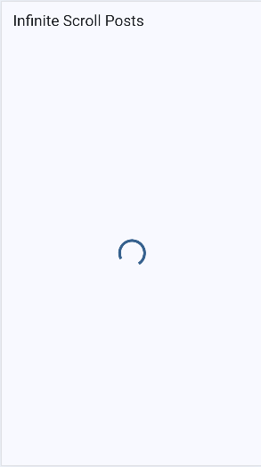
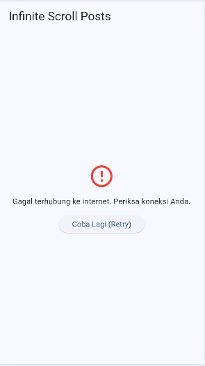

# Week 09 | AI-Assisted Development / Vibe Coding

Repository Portfolio Mata Kuliah Pemrograman Mobile  
**NIM:** 244107020029  
**Topik:** Workflow AI-Assisted Development (Prompt, Generate, Verify, Test, Refactor, Explain), Pencegahan Halusinasi, dan Clean Architecture Refactoring.

---

## 1. Deskripsi Fitur yang Ditambahkan

Pada minggu ini, proyek basis **Offline Notes** (`week5_offline_notes`) ditingkatkan dengan menambahkan fitur **Pencarian Catatan (*Search & Filter*)** yang dilengkapi dengan dua kondisi **Empty State** adaptif:
1. **Pencarian Reaktif & Case-Insensitive:** Pengguna dapat mencari catatan berdasarkan judul maupun isi catatan tanpa memedulikan huruf besar/kecil.
2. **Sanitasi Whitespace:** Input spasi kosong diabaikan sehingga tidak merusak daftar catatan.
3. **Empty State Adaptif:**
   - **Kondisi 1 (Database Kosong):** Menampilkan ikon `Icons.note_add_outlined` dan pesan `"Belum ada catatan. Klik + untuk membuat."`.
   - **Kondisi 2 (Hasil Tidak Ditemukan):** Menampilkan ikon `Icons.search_off` dan pesan `"Tidak ada catatan yang cocok dengan \"[query]\""`.
4. **Tombol Clear Instan:** Tombol `x` otomatis muncul saat kolom pencarian terisi untuk mereset query ke semula.

---

## 2. Arsitektur & Pemisahan Layer (Clean Architecture)

Fitur ini direkayasa ulang (*refactored*) dari usulan awal AI yang monolitik menjadi 3 layer terpisah:

```
[UI / Presentation Layer]
SearchNotesPage (lib/pages/search_notes_page.dart)
    │ (watch/read state)
    ▼
[State Management Layer]
NotesSearchNotifier (lib/presentation/notes_search_notifier.dart)
    │ (memanggil pure logic filter)
    ▼
[Domain Layer - Pure Dart]
filterNotes() (lib/domain/search_notes.dart)
    ▲
    │ (data source)
[Data Layer - SQLite]
NoteRepository (lib/data/repositories/note_repository.dart)
```

- **Domain Layer (`lib/domain/search_notes.dart`):**  
  Berisi use case murni `filterNotes(List<Note> notes, String query)` tanpa dependensi Flutter, SQLite, maupun Dio. Memenuhi *Dependency Rule*.
- **Presentation Layer (`lib/presentation/notes_search_notifier.dart`):**  
  Menggunakan Riverpod `AsyncNotifier` untuk mengelola `NotesSearchState` (semua catatan, query aktif, dan hasil filter).
- **View Layer (`lib/pages/search_notes_page.dart`):**  
  Menangani interaksi pengguna, TextField pencarian, tombol clear, dan tampilan list atau empty state.

---

## 3. Formula Prompt 5 Slot

Prompt yang digunakan untuk memandu AI disusun menggunakan formula 5 slot yang ketat:
- **Peran:** Senior Flutter Developer.
- **Konteks:** Flutter 3.x, Riverpod (AsyncNotifier), SQLite offline-first, feature-first Clean Architecture.
- **Tugas:** Tambahkan search judul/isi catatan dengan use case murni, notifier reaktif, dan dua varian empty state di UI.
- **Batas:** Jangan panggil SQLite dari widget, jangan ubah arsitektur dasar, fungsi murni tanpa import framework, maks 80 baris per fungsi.
- **Output:** Kode domain use case, notifier state, UI page, 3 test case (unit + widget test), dan cara uji.

Dokumentasi lengkap prompt mentah dan output awal AI tersedia di:  
📄 [docs/ai-log.md](file:///d:/github/Mobile/244107020029-mobile-course/09-week-9-ai-assisted-development/docs/ai-log.md)

---

## 4. Bukti Mesin Hijau (Green Builds)

### 4.1. Hasil `flutter analyze`
```text
Analyzing week5_offline_notes...
No issues found! (ran in 12.8s)
```

### 4.2. Hasil `dart format --set-exit-if-changed .`
```text
Formatted 20 files (0 changed) in 0.23 seconds.
```

### 4.3. Hasil `flutter test`
```text
00:00 +0: filterNotes - Unit Test Use Case Domain filter abaikan huruf besar/kecil
00:00 +1: filterNotes - Unit Test Use Case Domain query kosong atau hanya spasi kembalikan semua catatan
00:00 +2: filterNotes - Unit Test Use Case Domain query tak cocok kembalikan list kosong
00:00 +3: filterNotes - Unit Test Use Case Domain pencarian cocok pada isi catatan (body match)
00:00 +4: filterNotes - Unit Test Use Case Domain pencarian cocok sebagian kata (substring match)
00:00 +5: filterNotes - Unit Test Use Case Domain menangani list catatan kosong tanpa crash
00:00 +6: SearchNotesPage - Widget Test Empty State menampilkan empty state umum ketika tidak ada catatan
00:04 +14: SearchNotesPage - Widget Test Empty State menampilkan empty state pencarian saat query tidak cocok
00:04 +15: SearchNotesPage - Widget Test Empty State menampilkan list catatan saat ada data cocok
00:05 +16: Smoke test verifikasi UI NotesPage dan validator catatan
00:08 +17: All tests passed!
```

---

## 5. Tabel Verifikasi Saran AI (AI Challenge)

| No | Rekomendasi AI | Status | Alasan Teknis & Bukti |
|:--:|---|:---:|---|
| **1** | Validasi sanitasi whitespace (`query.trim().isEmpty`) | **Diterima** | **Bukti:** Mengetik spasi `"   "` tidak lagi menyembunyikan catatan; unit test membuktikan `filterNotes(notes, '   ')` mengembalikan seluruh catatan. |
| **2** | Pemisahan filter ke domain layer murni (`lib/domain/`) | **Diterima** | **Bukti:** Menghilangkan coupling antara UI dan logika bisnis. Memungkinkan eksekusi 6 unit test berjalan dalam milidetik tanpa merender widget tree. |
| **3** | Migrasi SQLite ke virtual table FTS5 (Full-Text Search) | **Ditolak** | **Alasan:** *Over-engineering* berlebihan untuk skala catatan offline lokal. FTS5 memerlukan perubahan skema DDL yang rentan error di FFI multi-platform tanpa memberikan manfaat performa yang signifikan dibandingkan filter in-memory. |

---

## 6. Bukti Visual & Screenshot

| Tampilan Daftar Catatan & Fitur Pencarian | Bukti Pengujian & Validasi Offline |
|:---:|:---:|
|  |  |

---

## 7. Refleksi

### 1. Satu halusinasi AI apa yang Anda temukan dan bagaimana membuktikannya?
**Jawab:**
Halusinasi yang ditemukan adalah **AI mengusulkan pencarian SQL langsung dari widget menggunakan raw query `db.rawQuery("SELECT * FROM notes WHERE title LIKE '%$query%'")`** serta mengasumsikan adanya method helper `searchFuzzy()` pada repository yang sebenarnya tidak ada.  
**Cara membuktikannya:**
1. **Analisis Statis & Autocomplete:** Method `searchFuzzy()` tidak ditemukan di `NoteRepository` maupun `sqflite`.
2. **Review Arsitektur:** Pemanggilan `rawQuery` langsung dari widget melanggar prinsip *Separation of Concerns* (UI tidak boleh berbicara langsung dengan storage engine) dan berpotensi menimbulkan celah SQL Injection jika query tidak di-sanitize dengan benar.

---

### 2. Prompt mana yang paling membantu dan apa yang Anda ubah?
**Jawab:**
Prompt yang paling membantu adalah **prompt dengan batasan arsitektur eksplisit pada Slot Batas (*Constraints*)**:
> *"Batas: Jangan panggil SQLite dari widget, jangan ubah arsitektur dasar, gunakan pure Dart function untuk use case filter tanpa mengimpor package:flutter."*

**Yang diubah:**  
Sebelumnya ketika menggunakan prompt santai (*vibe coding* biasa seperti *"buatkan search notes"*), AI mencampurkan seluruh filter di dalam `setState` widget tree. Setelah menambahkan batasan Clean Architecture pada prompt, AI langsung membagi kode menjadi use case domain murni dan notifier reaktif yang terpisah rapi.

---

### 3. Satu refactor apa yang Anda lakukan pada kode AI?
**Jawab:**
Refactor paling krusial adalah **mengekstrak logika filter dari widget/notifier ke dalam use case murni `filterNotes(List<Note> notes, String query)` di `lib/domain/search_notes.dart`**.  
**Dampaknya:**
Kode filter menjadi *pure function* tanpa side-effect yang dapat diuji dengan unit test biasa secara independen tanpa memerlukan mock database SQLite maupun inisialisasi Flutter widget tester.

---

### 4. Keputusan terima/tolak mana yang paling sulit?
**Jawab:**
Keputusan paling sulit adalah **menolak usulan AI untuk mengimplementasikan SQLite FTS5 (Full-Text Search)**.  
Secara teori, FTS5 terdengar sangat canggih dan profesional untuk pencarian teks. Namun setelah dievaluasi, mengimplementasikan FTS5 di Flutter desktop/mobile dengan `sqflite_common_ffi` memerlukan kompilasi native extension khusus, penulisan migrasi skema tabel virtual, dan penanganan sinkronisasi dua tabel. Untuk kebutuhan aplikasi catatan offline berskala ratusan catatan, filter in-memory di layer domain jauh lebih andal, mudah dimaintain, dan tidak membawa risiko kompatibilitas platform. Keputusan menolak ini didasarkan pada prinsip **KISS (Keep It Simple, Stupid)** dan **YAGNI (You Aren't Gonna Need It)**.

---

## 8. Struktur Berkas Week 9

```text
09-week-9-ai-assisted-development/
├── README.md                      # Laporan lengkap, bukti mesin hijau, dan refleksi
├── docs/
│   └── ai-log.md                  # Log prompt 5 slot, verifikasi 6 langkah, dan AI challenge
└── screenshots/
    ├── week5.png                  # Screenshot UI aplikasi
    └── buktiweek5.png             # Screenshot pengujian aplikasi
```
Dokumen kode sumber:
- Use Case Domain: [search_notes.dart](file:///d:/github/Mobile/244107020029-mobile-course/05-week-5-local-storage-offline-first/week5_offline_notes/lib/domain/search_notes.dart)
- Search Notifier: [notes_search_notifier.dart](file:///d:/github/Mobile/244107020029-mobile-course/05-week-5-local-storage-offline-first/week5_offline_notes/lib/presentation/notes_search_notifier.dart)
- UI Search Page: [search_notes_page.dart](file:///d:/github/Mobile/244107020029-mobile-course/05-week-5-local-storage-offline-first/week5_offline_notes/lib/pages/search_notes_page.dart)
- Test Suite: [search_filter_test.dart](file:///d:/github/Mobile/244107020029-mobile-course/05-week-5-local-storage-offline-first/week5_offline_notes/test/search_filter_test.dart)
