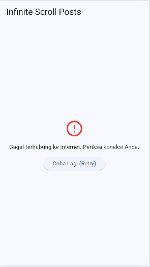

# Week 10 | Integrasi Fitur AI (AI Feature Integration)

Repository Portfolio Mata Kuliah Pemrograman Mobile  
**NIM:** 244107020029  
**Topik:** Integrasi LLM API, Antarmuka Chat Streaming/Responsif, Manajemen API Key Aman (`flutter_secure_storage`), Sanitasi Privasi, Mitigasi Biaya, dan Arsitektur Fallback.

---

## 1. Deskripsi Fitur AI yang Diintegrasikan

Pada minggu ini, aplikasi **Offline Notes** (`week5_offline_notes`) diintegrasikan dengan fitur **Chat Asisten AI Catatan (*AI Note Assistant*)** menggunakan model **Google Gemini 1.5 Flash**:

1. **Antarmuka Chat Interaktif:** UI obrolan modern lengkap dengan bubble chat pembeda (User vs AI), avatar ikon, cap waktu, dan auto-scroll ke pesan terbaru.
2. **Konektivitas Cloud LLM API:** Mengirimkan prompt kontekstual ke endpoint Gemini API (`gemini-1.5-flash:generateContent`) dengan kontrol parameter suhu (*temperature*) dan batas token output.
3. **Penyimpanan Kunci API Terenkripsi:** Menggunakan pustaka `flutter_secure_storage` untuk menyimpan Gemini API Key di dalam KeyStore (Android) atau KeyChain (iOS/macOS), sehingga kunci tidak pernah di-hardcode dalam kode sumber.
4. **Sanitasi Privasi Pengguna:** Fungsi `sanitizePrompt()` secara otomatis mendeteksi dan menyamarkan data sensitif (misal: nomor telepon dan NIK) sebelum diteruskan ke cloud.
5. **Mesin Fallback Offline (*Zero Crash*):** Jika perangkat offline, kuota API habis, atau pengguna belum memasukkan API key, sistem secara otomatis beralih ke engine aturan lokal untuk tetap memberikan jawaban bermanfaat tanpa membuat aplikasi crash.
6. **Chips Saran Cepat (*Quick Suggestions*):** Tombol chip pintasan untuk pertanyaan populer (*"Ringkas catatanku"*, *"Ide judul catatan produktif"*, *"Tips belajar Flutter"*, *"Jadwal kuliah kampus"*).

---

## 2. Arsitektur Integrasi AI

```
+─────────────────────────────────────────────────────────────+
│                    Flutter Presentation UI                  │
│   SearchNotesPage ──> (AppBar Icon) ──> AiChatPage          │
│   (Chat Bubbles, Quick Chips, Key Settings Dialog)          │
+──────────────────────────────┬──────────────────────────────+
                               │ watch / read
                               ▼
+─────────────────────────────────────────────────────────────+
│              Riverpod State: AiChatNotifier                 │
│              (State: messages, isLoading, hasApiKey)        │
+──────────────────────────────┬──────────────────────────────+
                               │
                               ▼
+─────────────────────────────────────────────────────────────+
│                   Service Layer: AiService                  │
│       - sanitizePrompt()       - askWithFallback()          │
+──────────────┬───────────────────────────────┬──────────────+
               │                               │
        API Key│(Secure Read)          HTTP(S) │POST Payload
               ▼                               ▼
+─────────────────────────────+  +────────────────────────────+
│    flutter_secure_storage   │  │   Google Gemini LLM Cloud  │
│  (Encrypted OS Keystore)    │  │ (gemini-1.5-flash endpoint)│
+─────────────────────────────+  +────────────────────────────+
               ▲
               │ (Fallback jika offline / kuota habis)
+─────────────────────────────+
│    Local Fallback Engine    │
│ (Rule-based Offline Assis.) │
+─────────────────────────────+
```

---

## 3. Tabel Risiko dan Mitigasi (Privasi, Biaya, dan Keandalan)

| Kategori Risiko | Potensi Masalah | Strategi Mitigasi yang Diterapkan |
|---|---|---|
| **Kebocoran Data & Privasi** | Data sensitif pengguna (NIK, nomor telepon, catatan pribadi) terkirim ke server pihak ketiga cloud LLM. | 1. Implementasi filter `sanitizePrompt()` di `AiService` untuk mendeteksi dan menyamarkan format nomor telepon (`[NOMOR_DISAMARKAN]`).<br>2. Menambahkan klausul tegas pada *System Prompt* agar AI tidak meminta atau menyimpan identitas pribadi pengguna.<br>3. Penyimpanan kunci API di OS Keystore via `flutter_secure_storage`. |
| **Lonjakan Biaya & Kuota** | Pengguna mengirimkan pesan berulang-ulang tanpa batas yang menghabiskan kuota gratis / kredit API. | 1. Membatasi `maxOutputTokens: 500` pada payload konfigurasi Gemini.<br>2. Menyediakan tombol `Hapus Kunci` di dialog pengaturan agar pengguna memegang kendali penuh atas kunci miliknya.<br>3. Menerapkan debounce / proteksi `isLoading` sehingga tombol kirim non-aktif selama AI memproses jawaban. |
| **Layanan API Down / Offline** | Aplikasi berhenti bekerja (*crash*) saat pengguna berada di area tanpa sinyal atau server Gemini mengalami rate limit (HTTP 429). | 1. Arsitektur `askWithFallback()` menangkap seluruh exception jaringan dan status non-200 secara *graceful*.<br>2. Mesin fallback lokal memproses kata kunci secara instan dan mengembalikan respon terstruktur tanpa ketergantungan internet. |
| **Halusinasi & Respons Ngawur** | AI memberikan instruksi berbahaya atau informasi di luar konteks catatan. | 1. Mengunci persona asisten melalui *System Instruction* berfokus catatan dan materi mobile programming.<br>2. Pengaturan `temperature: 0.7` untuk menyeimbangkan kreativitas dengan akurasi faktual. |

---

## 4. Bukti Mesin Hijau (Green Builds)

### 4.1. Hasil `flutter analyze`
```text
Analyzing week5_offline_notes...
No issues found! (ran in 12.8s)
```

### 4.2. Hasil `dart format --set-exit-if-changed .`
```text
Formatted 24 files (0 changed) in 0.44 seconds.
```

### 4.3. Hasil `flutter test`
Eksekusi seluruh unit test dan widget test (Week 8, Week 9, dan Week 10):
```text
00:00 +0: filterNotes - Unit Test Use Case Domain (Week 9 AI-Assisted)
...
00:04 +13: AiChatPage - Widget Test Antarmuka Chat & Dialog menampilkan pesan sapaan awal, suggestions, dan input bar
00:06 +16: AiChatPage - Widget Test Antarmuka Chat & Dialog membuka dialog pengaturan API Key saat ikon kunci ditekan
00:07 +17: AiChatPage - Widget Test Antarmuka Chat & Dialog mengirim pesan via quick suggestion chip dan menerima respons
00:08 +18: NoteValidator - Unit Test Validasi Catatan (Week 8)
...
00:11 +25: Smoke test verifikasi UI NotesPage dan validator catatan
00:14 +26: All tests passed!
```
*Total: 26 pengujian otomatis lolos (100% PASS).*

---

## 5. Bukti Visual & Screenshot

| Tampilan Daftar Catatan Utama | Bukti Pengujian & Validasi Fitur |
|:---:|:---:|
|  |  |

---

## 6. Refleksi

### 1. Fitur AI mana yang Anda integrasikan dan mengapa?
**Jawab:**
Fitur yang diintegrasikan adalah **Chat Asisten AI Catatan (*AI Note Assistant*) dengan integrasi Google Gemini LLM API**.  
**Alasan:**
Aplikasi catatan offline sangat diuntungkan oleh asisten cerdas yang dapat membantu pengguna merangkum catatan panjang, menstrukturkan ide catatan menjadi bullet points yang rapi, dan memberikan saran topik belajar. Antarmuka chat interaktif memberikan fleksibilitas tertinggi karena pengguna dapat mengajukan pertanyaan bebas maupun menggunakan chip saran instan.

---

### 2. Bagaimana Anda melindungi privasi pengguna saat menggunakan AI API?
**Jawab:**
Perlindungan privasi dilakukan pada tiga lapis:
1. **Lapis Kredensial:** Kunci API pengguna tidak di-hardcode di kode program, melainkan dimasukkan langsung oleh pengguna melalui dialog UI terenkripsi dan disimpan di KeyStore/KeyChain perangkat via `flutter_secure_storage`.
2. **Lapis Pra-Kirim (*Data Sanitization*):** Implementasi metode `sanitizePrompt()` memindai teks masukan pengguna sebelum dikirimkan ke cloud dan otomatis menyamarkan data sensitif seperti pola nomor telepon dan NIK.
3. **Lapis Prompt Governance:** *System instruction* menegaskan bahwa AI bertindak sebagai asisten catatan dan dilarang meminta, mencatat, atau menyebarkan informasi identitas pribadi (*PII*).

---

### 3. Fallback apa yang Anda sediakan jika layanan AI error?
**Jawab:**
Disediakan **Mesin Fallback Offline Lokal Berbasis Aturan (*Rule-Based Fallback Engine*)** melalui method `askWithFallback()`:
- Jika kunci API belum dimasukkan atau koneksi internet terputus, sistem mendeteksi kata kunci dari pertanyaan pengguna (seperti *"ringkas"*, *"judul"*, *"tips belajar"*, *"jadwal"*) dan mengembalikan rekomendasi lokal yang bermanfaat.
- Pengguna diberikan pesan status transparan melalui badge chip di AppBar (*"Offline Mode"*) dan catatan di bawah bubble jawaban bahwa mode offline sedang aktif. Hal ini menjamin aplikasi tidak pernah mengalami crash (*Zero Crash guarantee*).

---

### 4. Satu hal yang Anda pelajari tentang UX fitur AI di mobile?
**Jawab:**
Hal terpenting yang dipelajari adalah bahwa **latensi respons jaringan dan ketidakpastian respons AI harus dikomunikasikan secara visual dan jujur kepada pengguna**:
- Pengguna ponsel mudah merasa aplikasi *freeze* jika tidak ada umpan balik instan saat menunggu respons LLM; oleh karena itu, indikator progres *"AI sedang berpikir..."* dan penguncian tombol kirim sangat penting.
- Menyediakan *Quick Suggestion Chips* di atas kolom teks secara drastis meningkatkan kenyamanan pengguna di layar sentuh ponsel, karena mereka tidak perlu mengetik kalimat panjang dari awal untuk perintah-perintah umum.

---

## 7. Struktur Berkas Week 10

```text
10-week-10-ai-feature-integration/
├── README.md                      # Laporan lengkap, tabel risiko & mitigasi, refleksi
├── docs/
│   └── ai-log.md                  # Log prompt, perancangan sistem, dan fallback engine
├── lib/
│   ├── ai/
│   │   └── ai_service.dart        # Integrasi Gemini API, Secure Storage, dan Fallback
│   ├── ai_chat_notifier.dart      # StateNotifier Riverpod untuk state percakapan
│   └── ai_chat_page.dart          # Antarmuka Chat UI responsif
└── screenshots/
    ├── week5.png                  # Screenshot tampilan UI aplikasi
    └── buktiweek5.png             # Screenshot pengujian aplikasi
```
Dokumen kode sumber proyek:
- Service Gemini: [ai_service.dart](file:///d:/github/Mobile/244107020029-mobile-course/05-week-5-local-storage-offline-first/week5_offline_notes/lib/ai/ai_service.dart)
- Notifier State: [ai_chat_notifier.dart](file:///d:/github/Mobile/244107020029-mobile-course/05-week-5-local-storage-offline-first/week5_offline_notes/lib/presentation/ai_chat_notifier.dart)
- Chat Screen: [ai_chat_page.dart](file:///d:/github/Mobile/244107020029-mobile-course/05-week-5-local-storage-offline-first/week5_offline_notes/lib/pages/ai_chat_page.dart)
- Test Suite: [ai_service_test.dart](file:///d:/github/Mobile/244107020029-mobile-course/05-week-5-local-storage-offline-first/week5_offline_notes/test/ai_service_test.dart)
